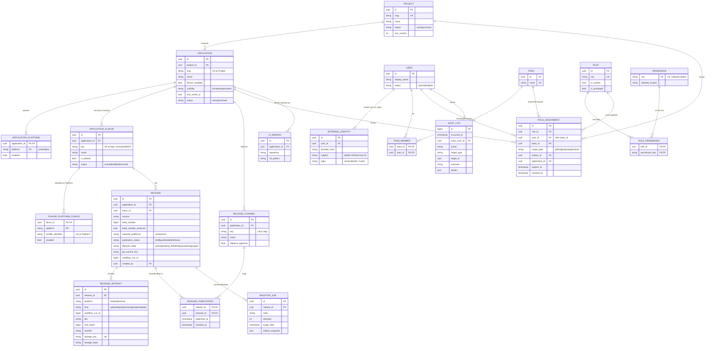
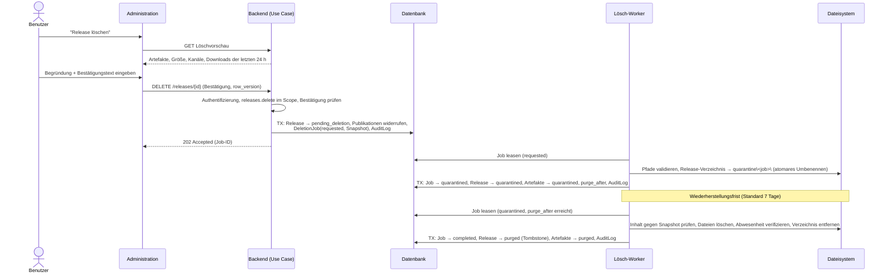
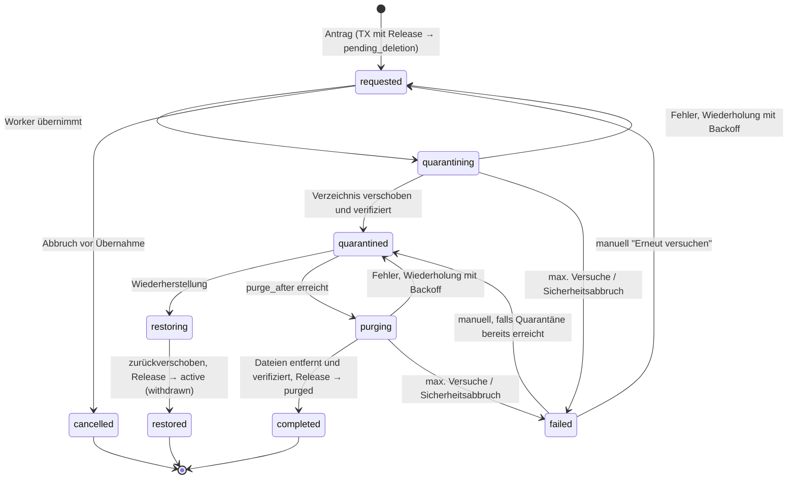

# Architekturkonzept – App-Distributionsplattform (HockeyKit-Nachfolge)

> **Status:** Entwurf zur Freigabe · **Stand:** 2026-10-17 · **Autor:** Lukas Kuntze
>
> Dieses Dokument erweitert das Architekturkonzept um Projektverwaltung, Flutter-Flavors, Release-Lifecycle, Berechtigungen und Dateisystemverwaltung. Es ist **nicht** freigegeben; vor der Freigabe wird nichts implementiert.

---

## Inhalt

0. [Kontext und Annahmen](#0-kontext-und-annahmen)
1. [Begriffe: Flavor, Build-Konfiguration, Release-Kanal](#1-begriffe-flavor-build-konfiguration-release-kanal)
2. [Fachliches Domänenmodell](#2-fachliches-domänenmodell)
3. [Relationales Datenmodell und ER-Diagramm](#3-relationales-datenmodell-und-er-diagramm)
4. [Berechtigungskonzept](#4-berechtigungskonzept)
5. [Dateisystemkonzept](#5-dateisystemkonzept)
6. [Release-Lifecycle und sichere Löschung](#6-release-lifecycle-und-sichere-löschung)
7. [UI-Konzept der Administration](#7-ui-konzept-der-administration)
8. [Einordnung in die Codestruktur](#8-einordnung-in-die-codestruktur)
9. [Antworten auf die Architekturfragen](#9-antworten-auf-die-architekturfragen)
10. [Migration einer bestehenden HockeyKit-Installation](#10-migration-einer-bestehenden-hockeykit-installation)
11. [Erweiterter MVP-Umfang](#11-erweiterter-mvp-umfang)
12. [Offene Architekturentscheidungen](#12-offene-architekturentscheidungen)

---

## 0. Kontext und Annahmen

Die Plattform verteilt intern entwickelte Apps für Android und iOS an Tester, Mitarbeitende und Kunden, gebaut mit Flutter oder .NET MAUI. Beide liefern APK/AAB und IPA aus, das Modell unterscheidet sie nur als Information (`applications.framework`). Bei MAUI-Apps entsprechen Build-Varianten den Flavors. Die Plattform ersetzt eine HockeyKit-Installation.

Diesem Dokument liegen folgende Annahmen zugrunde. Weicht eine davon ab, sind die betroffenen Abschnitte zu überarbeiten.

| Nr. | Annahme                                                                                                                                                                                               |
| --- | ----------------------------------------------------------------------------------------------------------------------------------------------------------------------------------------------------- |
| A1  | Betrieb auf Windows Server mit IIS als Reverse Proxy (URL Rewrite / ARR) vor einem Node.js-24-Dienst (TypeScript, Fastify gemäß DevX-Template).                                                       |
| A2  | Anmeldung über GitHub (OAuth), wahlweise github.com oder GitHub Enterprise (Server bzw. GHE.com). Die Organisationsmitgliedschaft entscheidet nur, _ob_ sich jemand anmelden darf, nicht über Rechte. |
| A3  | Artefakte werden überwiegend von GitHub-Actions-Workflows hochgeladen, in Ausnahmefällen manuell über die Oberfläche.                                                                                 |
| A4  | **SQLite** als eingebettete Datenbank in einer Datei auf dem Server, kein separater Datenbankserver (siehe [E1](#12-offene-architekturentscheidungen), entschieden, und 3.7).                         |
| A5  | Artefakte liegen auf einem lokalen NTFS-Volume des Servers, außerhalb des IIS-Webroots. Objektspeicher (S3/Azure Blob) ist für später vorgesehen, nicht im MVP.                                       |
| A6  | Die Oberfläche folgt dem Styleguide unter [reference/styleguide/](../../reference/styleguide/).                                                                                                       |

Leitprinzipien:

- **Die Datenbank ist die Quelle der Wahrheit**, das Dateisystem ist ein Objektspeicher, der ausschließlich über interne IDs adressiert wird.
- **Nichts Sicherheitsrelevantes wird hart gelöscht**: Projekte, Anwendungen und Flavors werden archiviert, Releases hinterlassen einen Tombstone, Rechte werden widerrufen statt gelöscht.
- **Jede Dateisystemoperation ist wiederholbar** (idempotent) und wird von einem Job in der Datenbank gesteuert.

---

## 1. Begriffe: Flavor, Build-Konfiguration, Release-Kanal

Die drei Begriffe beschreiben unterschiedliche Achsen und werden **nicht** gleichgesetzt.

| Begriff                 | Frage, die er beantwortet                      | Entsteht                                                               | Ändert das Binary?                     | Abbildung im Modell                                                         |
| ----------------------- | ---------------------------------------------- | ---------------------------------------------------------------------- | -------------------------------------- | --------------------------------------------------------------------------- |
| **Flutter-Flavor**      | _Welche Variante der App ist das?_             | zur Build-Zeit (`--flavor`)                                            | ja, eigenes installierbares Binary     | Entität `ApplicationFlavor` mit eigener Package-ID / Bundle-ID je Plattform |
| **Build-Konfiguration** | _Wie wurde kompiliert?_                        | zur Build-Zeit (`debug`/`profile`/`release`, iOS-Build-Configurations) | ja, technisch (Optimierung, Debugging) | Attribut `build_mode` am Artefakt, keine eigene Entität                     |
| **Release-Kanal**       | _Für wen und mit welcher Reife wird verteilt?_ | nach dem Build, durch Veröffentlichung                                 | nein, dasselbe Binary wird freigegeben | Entität `ReleaseChannel`, Zuordnung über `ReleasePublication`               |

**Begründung:**

- Ein **Flavor** erzeugt ein _anderes Produkt_: Auf Android hat er eine eigene `applicationId`, auf iOS einen eigenen Bundle Identifier. Er hat einen eigenen App-Namen, eigene Icons und eigene Endpunkte. Zwei Flavors lassen sich parallel auf demselben Gerät installieren. Im Beispiel sind `Production` und `Unterstützung` von _K Mobile_ Flavors.
- Eine **Build-Konfiguration** ist eine technische Eigenschaft eines konkreten Builds. Auf iOS heißen Build-Configurations bei Flutter-Flavors zwar `Release-production` usw., der Flavor-Anteil darin ist aber nur eine Namenskonvention. Die Plattform speichert nur den Build-Modus. Verteilt werden in der Regel nur `release`-Builds; `profile` ist optional für Performance-Tests.
- Ein **Release-Kanal** (z. B. `intern`, `test`, `stabil`) ist eine _Veröffentlichungsentscheidung_. Dasselbe Release kann zuerst in `test` und nach Abnahme in `stabil` erscheinen, ohne neu gebaut oder hochgeladen zu werden.

Ein Flavor namens „Production“ ist deshalb **nicht** dasselbe wie ein Kanal „stabil“. Ein Production-Flavor-Build kann zunächst nur im Kanal `test` stehen.

---

## 2. Fachliches Domänenmodell

### 2.1 Hierarchie

```text
Project ─1:n─ Application ─1:n─ ApplicationFlavor ─1:n─ Release ─1:n─ ReleaseArtifact
                   │                    │                   │
                   │                    └─1:n─ FlavorPlatformConfig (Package Name / Bundle ID je Plattform)
                   ├─1:n─ ReleaseChannel ───────n:m (ReleasePublication)───┘
                   └─1:n─ ApplicationPlatform (Android / iOS aktiviert)
```

### 2.2 Aggregate und Invarianten

| Aggregat       | Wurzel              | Wichtige Invarianten                                                                                                                                                                                                                                                                                                                             |
| -------------- | ------------------- | ------------------------------------------------------------------------------------------------------------------------------------------------------------------------------------------------------------------------------------------------------------------------------------------------------------------------------------------------ |
| Projekt        | `Project`           | Slug eindeutig. Archivieren nur, wenn kein Release in Löschung ist. Hart löschen nur, wenn das Projekt nie Anwendungen hatte.                                                                                                                                                                                                                    |
| Anwendung      | `Application`       | Gehört genau einem Projekt. Hat **immer genau einen Default-Flavor**. Mindestens eine Plattform ist aktiviert, bevor Releases angelegt werden.                                                                                                                                                                                                   |
| Flavor         | `ApplicationFlavor` | Der technische Schlüssel (`key`, entspricht `--flavor`) ist eindeutig je Anwendung und nach dem ersten Release unveränderlich. Package-ID / Bundle-ID ist plattformweit eindeutig.                                                                                                                                                               |
| Release        | `Release`           | Umfasst **beide Plattformen**: IPA sowie APK/AAB derselben Version und Build-Nummer. Eindeutig je `(Flavor, Build-Nummer)`. Veröffentlichen nur, wenn jede geforderte Plattform ein Artefakt hat. Artefakte sind nach dem Upload unveränderlich. Ein Release ist entweder aktiv, in Löschung, in Quarantäne oder endgültig gelöscht (Tombstone). |
| Berechtigungen | `RoleAssignment`    | Bezieht sich auf einen Benutzer oder ein Team, eine Rolle und einen Geltungsbereich. Wird widerrufen, nie gelöscht.                                                                                                                                                                                                                              |
| Löschauftrag   | `DeletionJob`       | Höchstens ein aktiver Auftrag je Release. Abschluss nur nach verifizierter Bereinigung.                                                                                                                                                                                                                                                          |

### 2.3 Anwendungen ohne Flavors

Jede Anwendung erhält beim Anlegen automatisch einen **Default-Flavor** (`key = "default"`, `is_default = true`).

- Ist die Flavor-Unterstützung deaktiviert (`flavors_enabled = false`), blendet die Oberfläche den Flavor vollständig aus. Package-ID und Bundle-ID werden direkt in den Anwendungseinstellungen gepflegt, technisch landen sie am Default-Flavor. Es gibt keinen zusätzlichen Verwaltungsschritt.
- `Release.flavor_id` ist **immer gesetzt**. Eindeutigkeitsregeln, Fremdschlüssel, Speicherpfade und Berechtigungsprüfungen kennen daher keinen Sonderfall „ohne Flavor“; nullable Spalten in Unique-Indizes entfallen.
- Wird die Flavor-Unterstützung später aktiviert, wird der Default-Flavor sichtbar und kann umbenannt werden (z. B. in „Production“). Bestehende Releases behalten ihre IDs; es ist **keine Datenmigration** nötig.
- Deaktivieren ist nur möglich, solange höchstens ein aktiver Flavor existiert.

---

## 3. Relationales Datenmodell und ER-Diagramm

### 3.1 Konventionen

- **Primärschlüssel:** UUIDv7, in der Anwendung erzeugt (zeitlich sortierbar, nicht erratbar, ohne Datenbank-Roundtrip). Ausnahme: `audit_logs` mit fortlaufender `bigint`-Identität für eine lückenlos prüfbare Reihenfolge.
- **Zeitstempel:** UTC, in SQLite als ISO-8601-Text (`2026-10-17T08:15:30.123Z`), damit lexikografische Sortierung der zeitlichen entspricht.
- **Typen in SQLite:** UUIDs als `TEXT` (kanonisch, kleingeschrieben), JSON als `TEXT` mit `CHECK (json_valid(...))`, Wahrheitswerte als `INTEGER` 0/1 mit `CHECK`. Tabellen werden als `STRICT` angelegt, damit SQLite keine falschen Typen annimmt.
- **Optimistische Sperre:** `row_version` auf allen bearbeitbaren Stammdaten, damit gleichzeitige Bearbeitungen nicht still überschrieben werden.
- **Aufzählungen:** `CHECK`-Constraints oder kleine Lookup-Tabellen, keine nativen DB-Enums (bessere Migrierbarkeit zwischen DBMS und beim Erweitern).
- **Löschregel:** Standard ist `ON DELETE RESTRICT` (bzw. `NO ACTION`). `CASCADE` ist **nur** für reine Konfigurations-Verknüpfungstabellen ohne Sicherheits- oder Dateibezug erlaubt (siehe 3.5).

### 3.2 ER-Diagramm



### 3.3 Tabellen im Detail

Die Notation ist DBMS-neutral. „UK“ bezeichnet eine Eindeutigkeitsbedingung, „gefiltert“ einen partiellen Unique-Index.

#### Projekt- und Anwendungsstruktur

**`projects`**

| Spalte                                          | Typ / Regel                                                                                  |
| ----------------------------------------------- | -------------------------------------------------------------------------------------------- |
| `id`                                            | PK, UUID                                                                                     |
| `slug`                                          | UK; `^[a-z0-9]+(-[a-z0-9]+)*$`, max. 63 Zeichen; nur für URLs und Anzeige, **nie für Pfade** |
| `name`, `description`                           | Pflicht / optional                                                                           |
| `status`                                        | `active` \| `archived`                                                                       |
| `archived_at`, `archived_by`                    | gesetzt beim Archivieren                                                                     |
| `created_at/by`, `updated_at/by`, `row_version` | Änderungsinformationen                                                                       |

**`applications`**

| Spalte                     | Typ / Regel                                                                                                        |
| -------------------------- | ------------------------------------------------------------------------------------------------------------------ |
| `id`                       | PK                                                                                                                 |
| `project_id`               | FK → `projects`, RESTRICT; Index                                                                                   |
| `slug`                     | UK `(project_id, slug)`                                                                                            |
| `name`, `description`      |                                                                                                                    |
| `icon_asset_id`            | FK → `assets` (Icons und Screenshots, eigene Tabelle, analog zu Artefakten gespeichert)                            |
| `flavors_enabled`          | bool, Standard `false`                                                                                             |
| `visibility`               | `private` (nur explizit Berechtigte) \| `organization` (alle angemeldeten Benutzer dürfen lesen und herunterladen) |
| `public_page`              | JSON: Darstellungsoptionen der Download-Seite (Beschreibung, Installationshinweise, Sortierung, angezeigte Kanäle) |
| `status`, Änderungsspalten | wie oben                                                                                                           |

Darf eine Anwendung in ein anderes Projekt verschoben werden, ändert sich nur `project_id`. Speicherpfade sind davon nicht betroffen (siehe Kapitel 5).

**`application_platforms`**: PK `(application_id, platform)`, `platform ∈ {android, ios}`, `enabled`.

**`application_flavors`**

| Spalte                         | Typ / Regel                                                                                                      |
| ------------------------------ | ---------------------------------------------------------------------------------------------------------------- |
| `id`                           | PK                                                                                                               |
| `application_id`               | FK RESTRICT                                                                                                      |
| `key`                          | UK `(application_id, key)`; `^[a-z][a-zA-Z0-9]*$` (Flutter-/Gradle-kompatibel); nach dem ersten Release gesperrt |
| `name`, `description`          | frei änderbar                                                                                                    |
| `is_default`                   | gefilterter UK `(application_id) WHERE is_default`                                                               |
| `status`                       | `active` \| `disabled` (keine neuen Releases, bestehende bleiben sichtbar) \| `archived` (ausgeblendet)          |
| `publication_rules`            | JSON: z. B. erlaubte Kanäle, Pflicht zur Release Note, automatische Veröffentlichung                             |
| `sort_order`, Änderungsspalten |                                                                                                                  |

Zusätzlich UK `(id, application_id)` als Ziel des zusammengesetzten Fremdschlüssels aus `releases`.

**`flavor_platform_configs`**: PK `(flavor_id, platform)`; `bundle_identifier` (Android: Package Name, iOS: Bundle ID); UK `(platform, bundle_identifier)`, auch für archivierte Flavors, weil installierte Apps unter ihrer Kennung weiterleben; eine Zeile je gesetzter Kennung; optional später `min_os_version`. Verhindert, dass zwei Flavors dieselbe Kennung beanspruchen. Beim Upload wird die Kennung aus dem Binary (AndroidManifest bzw. Info.plist) gegen diesen Eintrag geprüft.

**`release_channels`**: PK `id`; FK `application_id`; UK `(application_id, key)`; `name`, `description`, `requires_approval`, `sort_order`, `status`. Kanäle gehören zur Anwendung; projektweite Vorlagen sind eine spätere Erweiterung.

**`ci_bindings`**: welches Repository bzw. welcher Workflow Releases für eine Anwendung hochladen darf. Spalten: `application_id`, `repository` (GHE-Repository-ID **und** Name), `ref_pattern`, optional `environment`, `allowed_flavor_ids`. Grundlage für Uploads mit GitHub-Actions-OIDC-Token (siehe 4.7).

#### Releases

**`releases`**

| Spalte                                                               | Typ / Regel                                                                                                                                                         |
| -------------------------------------------------------------------- | ------------------------------------------------------------------------------------------------------------------------------------------------------------------- |
| `id`                                                                 | PK                                                                                                                                                                  |
| `application_id`                                                     | FK; denormalisiert für Scope-Prüfungen und Indizes                                                                                                                  |
| `flavor_id`                                                          | zusammengesetzter FK `(flavor_id, application_id)` → `application_flavors(id, application_id)`, RESTRICT; erzwingt, dass Flavor und Anwendung zusammenpassen        |
| `required_platforms`                                                 | Plattformen, für die ein installierbares Artefakt vorliegen muss; beim Anlegen aus den aktivierten Plattformen des Flavors übernommen (Regelfall: `android`, `ios`) |
| `version`                                                            | String wie im Build (`4.13.0`, optional `-beta.1`), max. 64 Zeichen                                                                                                 |
| `version_major`, `version_minor`, `version_patch`, `version_pre`     | geparst, für Sortierung und Filter                                                                                                                                  |
| `build_number`                                                       | `bigint > 0`, Flutter `--build-number`, Android `versionCode`, iOS `CFBundleVersion`                                                                                |
| `release_notes`                                                      | Markdown, für Endbenutzer                                                                                                                                           |
| `changelog`                                                          | Markdown, technisch (z. B. aus Commits generiert)                                                                                                                   |
| `git_repository`, `git_commit_sha` (40 Hex), `git_branch`, `git_tag` | Herkunft                                                                                                                                                            |
| `workflow_run_id`, `workflow_run_attempt`, `workflow_run_url`        | GitHub-Actions-Lauf, der das Release angelegt hat; der Lauf je Artefakt steht in `release_artifacts`                                                                |
| `build_number_reserved`                                              | bool, Standard `true`; sperrt die Build-Nummer. Nur bei `purged` per Admin-Freigabe auf `false` setzbar (siehe unten)                                               |
| `build_number_released_at/by`, `build_number_release_reason`         | Nachweis der Freigabe                                                                                                                                               |
| `publication_status`                                                 | `draft` \| `published` \| `withdrawn`                                                                                                                               |
| `published_at`, `published_by`                                       |                                                                                                                                                                     |
| `visibility`                                                         | `inherit` (von der Anwendung) \| `restricted` (nur Rolleninhaber der Anwendung)                                                                                     |
| `lifecycle_state`                                                    | `active` \| `pending_deletion` \| `quarantined` \| `purged`                                                                                                         |
| `deletion_requested_at/by`, `purged_at`                              | Löschinformationen (Tombstone)                                                                                                                                      |
| `imported_from`                                                      | optional, z. B. `hockeykit:<Pfad>`                                                                                                                                  |
| `created_at/by`, `updated_at/by`, `row_version`                      |                                                                                                                                                                     |

Eindeutigkeit und Indizes:

- **Gefilterter UK `(flavor_id, build_number) WHERE build_number_reserved`.** Eine Build-Nummer ist je Flavor eindeutig, auch über Löschungen hinweg (Tombstones sperren sie weiter). Damit kann kein Release versehentlich überschrieben werden.
- Die Versionsnummer ist **nicht** Teil des Schlüssels: Android verlangt eine eindeutige `versionCode`; gleiche Versionsnummern mit verschiedenen Builds (`4.13.0+125`, `4.13.0+126`) sind legitim.
- Index `(application_id, lifecycle_state, publication_status, published_at DESC)` für Listen.
- Index `(flavor_id, version_major DESC, version_minor DESC, version_patch DESC, build_number DESC)` für „neuestes Release“.
- Index `(git_commit_sha)` für die Suche nach Commits.

**Ein Release umfasst beide Plattformen** ([E3](#12-offene-architekturentscheidungen), entschieden). IPA und APK/AAB derselben Version und Build-Nummer gehören zu genau einem Release. Sie werden gemeinsam veröffentlicht, zurückgezogen und gelöscht.

- **Vollständigkeit:** Ein Release darf erst veröffentlicht werden, wenn für jede Plattform in `required_platforms` ein installierbares Artefakt vorliegt: iOS eine IPA, Android eine APK oder AAB. Bis dahin bleibt es `draft` und wird in der Oberfläche als „unvollständig“ markiert. Installationslinks entstehen nur für APK und IPA; eine AAB allein lässt sich ohne Store nicht direkt installieren.
- **Uploads aus getrennten Workflow-Läufen:** Android- und iOS-Build laufen meist in getrennten Jobs. Der erste Upload legt das Release als Entwurf an, der zweite hängt sein Artefakt an dasselbe Release an. Die Zuordnung erfolgt idempotent über `(flavor_id, build_number)`. Weicht die Versionsnummer oder der Commit-SHA des zweiten Uploads vom Release ab, wird er abgelehnt (409), damit nie Builds aus unterschiedlichen Ständen gemischt werden.
- Plattform und Workflow-Lauf stehen je Artefakt in `release_artifacts`, die Kennungsprüfung erfolgt je Artefakt gegen `flavor_platform_configs` seiner Plattform.

**Freigabe einer Build-Nummer zur Wiederverwendung** ([E4](#12-offene-architekturentscheidungen), entschieden): Grundsätzlich bleibt die Build-Nummer eines gelöschten Releases gesperrt. Ein Inhaber von `build_numbers.release` (Scope global oder Projekt) kann sie für ein Release im Zustand **`purged`** freigeben. Dazu setzt er `build_number_reserved = false` und gibt eine Pflicht-Begründung an; der Vorgang wird auditiert. Danach darf ein neues Release dieselbe Build-Nummer verwenden; der Tombstone bleibt erhalten.

- In Quarantäne befindliche Releases lassen sich nicht freigeben, weil sonst die Wiederherstellung mit dem neuen Release kollidieren würde.
- Der Freigabedialog weist auf die Folge hin: Geräte, auf denen der gelöschte Build installiert ist, erkennen einen neuen Build mit derselben Nummer nicht als Update. Android vergleicht `versionCode`, iOS `CFBundleVersion`.
- Die Freigabe ist endgültig. Ein Rückgängigmachen ist nicht vorgesehen, sobald ein neues Release die Nummer belegt.

**`release_artifacts`**

| Spalte                                                      | Typ / Regel                                                                                                                                                                        |
| ----------------------------------------------------------- | ---------------------------------------------------------------------------------------------------------------------------------------------------------------------------------- |
| `id`                                                        | PK; zugleich Dateiname im Speicher                                                                                                                                                 |
| `release_id`                                                | FK RESTRICT                                                                                                                                                                        |
| `platform`                                                  | `android` \| `ios` \| `NULL` (plattformunabhängig, z. B. `metadata`); aus `kind` abgeleitet und per `CHECK` erzwungen (`ipa`, `dsym` → `ios`; `apk`, `aab`, `mapping` → `android`) |
| `workflow_run_id`, `workflow_run_attempt`, `git_commit_sha` | Herkunft des einzelnen Artefakts; `git_commit_sha` muss dem Release entsprechen                                                                                                    |
| `kind`                                                      | `apk` \| `aab` \| `ipa` \| `dsym` \| `mapping` \| `metadata`, je Art genau eine feste Endung                                                                                       |
| `abi`                                                       | optional (`arm64-v8a`, `armeabi-v7a`, `x86_64`, `universal`)                                                                                                                       |
| `build_mode`                                                | `release` \| `profile` \| `debug`                                                                                                                                                  |
| `is_installable`                                            | bool; bestimmt, ob ein Installationslink angeboten wird                                                                                                                            |
| `original_file_name`                                        | nur zur Anzeige und als Download-Dateiname (bereinigt); nie für Pfade                                                                                                              |
| `content_type`, `size_bytes`, `sha256`                      | `sha256` wird beim Upload serverseitig berechnet und dient auch als ETag                                                                                                           |
| `storage_key`                                               | UK; relativer, aus IDs abgeleiteter Pfad (siehe 5.2), zur Verifikation gespeichert                                                                                                 |
| `storage_state`                                             | `uploading` \| `stored` \| `quarantined` \| `purged` \| `missing`                                                                                                                  |
| `uploaded_at/by`, `upload_source`                           | `ci` \| `ui` \| `import`                                                                                                                                                           |
| `purged_at`                                                 |                                                                                                                                                                                    |

UK `(release_id, kind, abi, build_mode)` (für `abi` mit `COALESCE` bzw. gefiltertem Index; `platform` folgt aus `kind`). Index `(release_id, platform)` für die Vollständigkeitsprüfung. Artefakte sind unveränderlich; ein falsches Artefakt wird entfernt und neu hochgeladen.

**`release_publications`**: PK `(release_id, channel_id)`; `published_at/by`, `revoked_at/by`. Ein Release kann in mehreren Kanälen stehen. Eine Veröffentlichung ist nur bei `publication_status = published` und `lifecycle_state = active` wirksam.

**`release_approvals`** (vorbereitet, nicht MVP): Vier-Augen-Freigabe für Kanäle mit `requires_approval`.

#### Identität und Berechtigungen

**`users`**: `id`, `display_name`, `email` (optional), `avatar_url`, `status` (`active` \| `disabled`), `created_at`, `last_login_at`. Benutzer werden nie hart gelöscht, sondern deaktiviert bzw. für den Datenschutz anonymisiert.

**`external_identities`**

| Spalte                      | Regel                                                                                         |
| --------------------------- | --------------------------------------------------------------------------------------------- |
| `user_id`                   | FK RESTRICT                                                                                   |
| `provider`, `provider_host` | `github`; Host z. B. `github.com` oder `github.example.com`                                   |
| `subject`                   | **numerische GitHub-User-ID** (stabil); UK `(provider, provider_host, subject)`               |
| `node_id`                   | GraphQL-Node-ID, zusätzlich gespeichert                                                       |
| `login`                     | Benutzername; veränderlich, wird bei jeder Anmeldung aktualisiert; Index, **nicht** eindeutig |
| `last_synced_at`            |                                                                                               |

Die eigene Entität ermöglicht später weitere Identitätsquellen (z. B. Entra ID für Kunden), ohne `users` umzubauen.

**`teams`**, **`team_members`**: plattforminterne Gruppen. Eine Synchronisation mit GitHub-Teams ist optional (siehe 4.6).

**`permissions`**: fester, im Code versionierter Katalog, per Migration geseedet. `key` (PK), `description`, `allowed_scopes` (z. B. `projects.create` nur `global`).

**`roles`**: `id`, `key` (UK), `name`, `description`, `is_system` (nicht löschbar), `is_privileged` (enthält mindestens eine administrative Berechtigung). **`role_permissions`**: PK `(role_id, permission_key)`.

**`role_assignments`**

| Spalte                                  | Regel                                          |
| --------------------------------------- | ---------------------------------------------- |
| `id`                                    | PK                                             |
| `role_id`                               | FK RESTRICT                                    |
| `user_id` / `team_id`                   | genau eines gesetzt (`CHECK`)                  |
| `scope_type`                            | `global` \| `project` \| `application`         |
| `project_id` / `application_id`         | passend zu `scope_type` (`CHECK`); FK RESTRICT |
| `granted_at/by`, `reason`, `expires_at` | Nachvollziehbarkeit, optional befristet        |
| `revoked_at/by`                         | Widerruf statt Löschung                        |

Gefilterter UK auf `(role_id, Principal, Scope) WHERE revoked_at IS NULL` verhindert doppelte aktive Zuweisungen. Indizes auf `(user_id) WHERE revoked_at IS NULL` und `(team_id) …` für die Berechtigungsauflösung.

#### Betrieb und Nachvollziehbarkeit

**`audit_logs`**: append-only.

| Spalte                                      | Regel                                                                       |
| ------------------------------------------- | --------------------------------------------------------------------------- |
| `id`                                        | `bigint` Identity, PK                                                       |
| `occurred_at`                               | UTC                                                                         |
| `actor_type`                                | `user` \| `ci` \| `system`                                                  |
| `actor_user_id`                             | FK ohne Cascade (Benutzer werden nie gelöscht)                              |
| `actor_label`                               | Snapshot: GitHub-Login bzw. Repository + Workflow-Lauf                      |
| `action`                                    | z. B. `release.delete.requested`, `role_assignment.granted`, `authz.denied` |
| `target_type`, `target_id`                  | ohne FK, damit Einträge jede Zielentität überdauern                         |
| `project_id`, `application_id`              | ohne FK; für gefilterte, scope-bezogene Audit-Ansichten                     |
| `outcome`                                   | `success` \| `denied` \| `failed`                                           |
| `correlation_id`, `client_ip`, `user_agent` |                                                                             |
| `details`                                   | JSON: Vorher-/Nachher-Werte, Snapshot der betroffenen Metadaten             |

Indizes auf `(occurred_at)`, `(target_type, target_id)`, `(application_id, occurred_at)`, `(actor_user_id, occurred_at)`. SQLite kennt keine Datenbankbenutzer und -rechte. Append-only wird deshalb über Trigger erzwungen: `BEFORE UPDATE` und `BEFORE DELETE` auf `audit_logs` brechen mit `RAISE(ABORT)` ab. Die Datei selbst schützt die Windows-ACL (5.4).

**`deletion_jobs`**

| Spalte                                      | Regel                                                                                                     |
| ------------------------------------------- | --------------------------------------------------------------------------------------------------------- |
| `id`                                        | PK                                                                                                        |
| `release_id`                                | FK RESTRICT                                                                                               |
| `requested_at/by`, `reason`                 | Pflichtangaben                                                                                            |
| `state`                                     | siehe 6.3                                                                                                 |
| `artifact_snapshot`                         | JSON: zum Zeitpunkt des Antrags validierte Liste aus `artifact_id`, `storage_key`, `size_bytes`, `sha256` |
| `quarantine_key`                            | relativer Quarantänepfad                                                                                  |
| `purge_after`                               | Ende der Wiederherstellungsfrist                                                                          |
| `attempts`, `next_attempt_at`, `last_error` | Wiederholungssteuerung                                                                                    |
| `locked_by`, `locked_until`                 | Lease für den Worker                                                                                      |
| `completed_at`, `restored_at/by`            |                                                                                                           |

Gefilterter UK `(release_id) WHERE state NOT IN ('completed', 'restored', 'cancelled')`: höchstens ein aktiver Auftrag je Release.

**`upload_sessions`**: steuert große und wiederaufnehmbare Uploads (`id`, `release_id`, `kind`, `expected_size`, `received_bytes`, `sha256_expected`, `state`, `expires_at`). Abgelaufene Sitzungen werden samt `.part`-Datei bereinigt.

**`download_events`** (optional, aggregierbar): für Statistiken. Persönliche Daten nur gemäß Datenschutzkonzept.

### 3.4 Entscheidungen zu zusätzlichen Entitäten

| Entität                        | Sinnvoll?   | Begründung                                                                                                                                                              |
| ------------------------------ | ----------- | ----------------------------------------------------------------------------------------------------------------------------------------------------------------------- |
| `ReleaseChannel`               | **ja, MVP** | Trennt Veröffentlichungsentscheidung vom Build (Kapitel 1).                                                                                                             |
| `ExternalIdentity`             | **ja, MVP** | Stabile GitHub-ID getrennt vom veränderlichen Login; offen für weitere Anbieter.                                                                                        |
| `ReleasePublication`           | **ja, MVP** | n:m zwischen Release und Kanal mit eigener Historie.                                                                                                                    |
| `CiBinding`                    | **ja, MVP** | Sichere Zuordnung von CI-Uploads zu Anwendungen.                                                                                                                        |
| `ReleaseApproval`              | später      | Erst nötig, wenn Kanäle mit Vier-Augen-Freigabe gebraucht werden; Schema ist vorbereitet (`requires_approval`).                                                         |
| `CustomerGroup` (Kundengruppe) | später      | Erst nötig, wenn externe Kunden nur bestimmte Kanäle oder Anwendungen sehen sollen. Modellierbar als Team mit Typ `customer` plus Kanal-Scope; bis dahin nicht anlegen. |

### 3.5 Löschregeln

| Beziehung                                         | Regel               | Begründung                                                                                   |
| ------------------------------------------------- | ------------------- | -------------------------------------------------------------------------------------------- |
| Projekt → Anwendung → Flavor → Release            | RESTRICT            | Fachdaten werden archiviert. Releases verschwinden nur über den Löschworkflow.               |
| Release → Artefakt                                | RESTRICT            | Dateien werden nur über `DeletionJob` entfernt, nie per Cascade.                             |
| Release → `deletion_jobs`, `release_publications` | RESTRICT            | Tombstone-Releases bleiben bestehen; Veröffentlichungen werden widerrufen (`revoked_at`).    |
| Benutzer / Team / Rolle → `role_assignments`      | RESTRICT            | Rechte werden widerrufen, damit die Historie erhalten bleibt.                                |
| Rolle → `role_permissions`                        | CASCADE zulässig    | Reine Konfiguration. Änderungen an Rollen werden trotzdem auditiert (Snapshot in `details`). |
| `audit_logs`                                      | keine FKs auf Ziele | Einträge überdauern jede Zielentität.                                                        |

Ein „Löschen“ in der Oberfläche bedeutet bei Projekten, Anwendungen und Flavors **Archivieren**. Hart gelöscht werden darf nur ein Objekt, das nie Releases hatte, auch keine Tombstones (Korrektur von Fehleingaben).

### 3.6 Datenintegrität und Migrationsfähigkeit

- Konsistenz zwischen Release, Flavor und Anwendung wird durch **zusammengesetzte Fremdschlüssel** in der Datenbank erzwungen, nicht nur im Code.
- Zustandsübergänge (`lifecycle_state`, `publication_status`, `deletion_jobs.state`) prüft die Domäne. Zusätzlich verhindern `CHECK`-Constraints unzulässige Kombinationen, z. B. `lifecycle_state = 'purged'` ohne `purged_at`.
- Migrationen sind versioniert, nur vorwärts gerichtet und liegen unter `src/backend/db/` (siehe Codestruktur). Breaking Changes folgen dem Muster **Expand → Migrate → Contract** über mindestens zwei Releases der Plattform.
- In der Anwendung erzeugte UUIDv7-Schlüssel, `CHECK`-Constraints statt Enums und der Verzicht auf SQLite-Eigenheiten in der Domäne halten einen späteren Wechsel auf einen Datenbankserver offen. Er beträfe nur `adapters/persistence/` und `db/`.

### 3.7 Betrieb mit SQLite

Gefilterte Unique-Indizes, zusammengesetzte Fremdschlüssel, `CHECK`, Transaktionen und JSON-Funktionen unterstützt SQLite vollständig. Für diese Plattform genügt es: wenige gleichzeitige Schreibvorgänge, ein Server, Datenmengen im Bereich von Megabytes, weil die Binaries im Dateisystem liegen. Verbindliche Einstellungen:

| Thema                | Festlegung                                                                                                                                                                                        |
| -------------------- | ------------------------------------------------------------------------------------------------------------------------------------------------------------------------------------------------- |
| Ablage               | `D:\AppDistribution\data\distribution.db` auf einem **lokalen** NTFS-Volume, nie auf einer Netzwerkfreigabe (Dateisperren sind dort unzuverlässig)                                                |
| Journal              | `PRAGMA journal_mode = WAL`: Lesende blockieren Schreibende nicht; Webdienst und Worker können die Datei gleichzeitig öffnen                                                                      |
| Pro Verbindung       | `PRAGMA foreign_keys = ON` (in SQLite sonst **aus**), `PRAGMA busy_timeout = 5000`, `PRAGMA synchronous = FULL`                                                                                   |
| Schreibtransaktionen | immer `BEGIN IMMEDIATE`, kurz halten; nie während eines Uploads, Downloads oder einer Dateioperation offen halten                                                                                 |
| Nebenläufigkeit      | SQLite erlaubt einen Schreiber zur Zeit. Der Job-Lease erfolgt atomar per `UPDATE … SET locked_by, locked_until … WHERE … RETURNING`, ein `SKIP LOCKED` ist nicht nötig                           |
| Treiber              | `better-sqlite3` (bewährt, synchron, vorkompilierte Windows-Binaries) oder das in Node eingebaute `node:sqlite`, sobald es als stabil gilt ([E15](#12-offene-architekturentscheidungen))          |
| Backup               | **nie** die Datei im laufenden Betrieb kopieren. Online-Backup über die SQLite-Backup-API bzw. `VACUUM INTO 'backup.db'` per Aufgabenplanung, anschließend `PRAGMA integrity_check` auf der Kopie |
| Wartung              | regelmäßig `PRAGMA optimize`; WAL-Checkpoints automatisch                                                                                                                                         |

Grenzen, die bewusst in Kauf genommen werden: kein Betrieb auf mehreren Webservern gleichzeitig und keine Datenbankbenutzer mit getrennten Rechten. Beides ist für eine interne Plattform auf einem Server vertretbar.

- Der Berechtigungskatalog wird per Migration geseedet. Neue Berechtigungen werden nie automatisch bestehenden Rollen hinzugefügt, außer der Systemrolle `platform-admin`.

---

## 4. Berechtigungskonzept

### 4.1 Grundsätze

1. **Anmeldung ≠ Berechtigung.** GitHub Enterprise authentifiziert. Die Mitgliedschaft in der konfigurierten Organisation ist nur Voraussetzung für die Anmeldung und verleiht keinerlei administrative Rechte.
2. **Zuordnung über die stabile GitHub-User-ID** (`external_identities.subject`). Eine Umbenennung des Logins ändert keine Rechte; ein neu vergebener alter Login erbt keine Rechte.
3. **Rollenbasiert mit Geltungsbereich (Scoped RBAC):** Berechtigungen werden zu Rollen gebündelt, Rollen werden mit einem Scope (global, Projekt, Anwendung) an Benutzer oder Teams vergeben.
4. **Nur erlaubende Regeln, keine Verbote (Deny).** Effektive Rechte sind die Vereinigung aller zutreffenden Zuweisungen. Das ist einfacher zu prüfen und zu erklären. Verbotsregeln sind bewusst nicht vorgesehen.
5. **Jede Prüfung erfolgt serverseitig im Use Case.** Die Oberfläche blendet Aktionen nur aus Komfortgründen aus.

### 4.2 Berechtigungskatalog

| Berechtigung          | Zulässige Scopes             | Bedeutung                                                                            |
| --------------------- | ---------------------------- | ------------------------------------------------------------------------------------ |
| `projects.read`       | global, project              | Projekt und Stammdaten sehen                                                         |
| `projects.create`     | global                       | Projekte anlegen                                                                     |
| `projects.update`     | global, project              | Projekt bearbeiten und archivieren                                                   |
| `projects.delete`     | global                       | Leere Projekte hart löschen                                                          |
| `applications.manage` | global, project, application | Anwendungen anlegen (Projekt-Scope) und bearbeiten, Plattformen, Darstellung, Kanäle |
| `flavors.manage`      | global, project, application | Flavors anlegen, bearbeiten, deaktivieren, archivieren                               |
| `releases.read`       | global, project, application | Releases inklusive Entwürfen sehen                                                   |
| `releases.create`     | global, project, application | Releases anlegen                                                                     |
| `releases.update`     | global, project, application | Metadaten bearbeiten                                                                 |
| `releases.publish`    | global, project, application | Veröffentlichen, zurückziehen, Kanäle zuordnen                                       |
| `releases.delete`     | global, project, application | Löschung beantragen (Quarantäne)                                                     |
| `artifacts.upload`    | global, project, application | Artefakte hochladen                                                                  |
| `artifacts.download`  | global, project, application | Artefakte herunterladen bzw. installieren                                            |
| `artifacts.delete`    | global, project, application | Einzelne Artefakte eines Releases entfernen                                          |
| `permissions.manage`  | global, project, application | Rollen innerhalb des eigenen Scopes vergeben (siehe 4.5)                             |

Vorgeschlagene Ergänzungen:

| Berechtigung            | Begründung                                                                                                                                             |
| ----------------------- | ------------------------------------------------------------------------------------------------------------------------------------------------------ |
| `releases.restore`      | Wiederherstellung aus der Quarantäne bewusst getrennt vergeben                                                                                         |
| `releases.purge`        | Sofortige endgültige Löschung ohne Wartefrist; nur global, nur für Notfälle (z. B. versehentlich veröffentlichte Geheimnisse)                          |
| `audit.read`            | Audit-Logs im eigenen Scope einsehen                                                                                                                   |
| `storage.manage`        | Speicherübersicht, fehlgeschlagene Löschaufträge und Abgleichsberichte; global                                                                         |
| `build_numbers.release` | Build-Nummer eines endgültig gelöschten Releases zur Wiederverwendung freigeben (E4); global oder Projekt; nur in `platform-admin` und `project-admin` |
| `shares.manage`         | Freigabelinks für Personen ohne Konto erstellen und widerrufen (4.8); in `platform-admin` und `project-admin`                                          |

### 4.3 Systemrollen (Vorschlag)

| Rolle             | Typischer Scope | Berechtigungen                                                                                                                                                                    |
| ----------------- | --------------- | --------------------------------------------------------------------------------------------------------------------------------------------------------------------------------- |
| `platform-admin`  | global          | alle                                                                                                                                                                              |
| `project-admin`   | project         | `projects.read/update`, `applications.manage`, `flavors.manage`, alle `releases.*` außer `purge`, alle `artifacts.*`, `build_numbers.release`, `permissions.manage`, `audit.read` |
| `release-manager` | project / app   | `releases.read/create/update/publish/delete/restore`, `artifacts.upload/download/delete`, `audit.read`                                                                            |
| `developer`       | project / app   | `releases.read/create/update`, `artifacts.upload/download`                                                                                                                        |
| `tester`          | project / app   | `releases.read`, `artifacts.download`                                                                                                                                             |
| `viewer`          | project / app   | `projects.read`, `artifacts.download` (nur veröffentlichte Releases)                                                                                                              |

Eigene Rollen sind möglich (z. B. „Release Manager ohne Löschrecht“). Das Recht zum Löschen kann zusätzlich einzeln über eine Rolle `release-deleter` (nur `releases.delete` und `releases.read`) gezielt an einzelne GitHub-Benutzer vergeben werden.

### 4.4 Vererbung und Auswertung

```text
global ──► Projekt ──► Anwendung ──► (Flavor, Release, Artefakt erben von der Anwendung)
```

Für eine Aktion auf einem Objekt werden die Scopes der Objektkette bestimmt (Release → Anwendung → Projekt → global). Die Berechtigung gilt, wenn **eine aktive, nicht abgelaufene Zuweisung** an den Benutzer oder eines seiner Teams auf **einem dieser Scopes** eine Rolle mit der Berechtigung enthält.

```text
erlaubt(user, permission, application) :=
  ∃ assignment a:
      a.revoked_at IS NULL ∧ (a.expires_at IS NULL ∨ a.expires_at > now)
    ∧ (a.user_id = user ∨ a.team_id ∈ teams(user))
    ∧ permission ∈ permissions(a.role)
    ∧ (  a.scope = global
       ∨ a.scope = project(application.project_id)
       ∨ a.scope = application(application.id) )
```

**Beispiel aus der Anforderung:** Ein Release Manager erhält `release-manager` mit Scope _Anwendung K Mobile_. Er darf Releases von K Mobile (beide Flavors) löschen. Für _Doku AirPad_ fehlt eine passende Zuweisung, die Aktion wird abgelehnt und als `authz.denied` auditiert.

Sichtbarkeit (`visibility = organization`) wirkt wie eine implizite Rolle `viewer` für alle angemeldeten Benutzer auf diese Anwendung. Sie verleiht nie Rechte über `projects.read` und `artifacts.download` hinaus und gilt nur für veröffentlichte, aktive Releases.

Flavor-spezifische Rechte (z. B. nur den Flavor _Unterstützung_ verwalten) sind im MVP nicht vorgesehen. Das Modell lässt einen Scope `flavor` später ohne Umbau zu ([E6](#12-offene-architekturentscheidungen)).

### 4.5 Schutz vor Rechteausweitung

- `permissions.manage` erlaubt nur die Vergabe von Rollen **im eigenen Scope oder darunter** und nur von Rollen, deren Berechtigungen der Vergebende im Ziel-Scope selbst besitzt.
- Rollen mit `is_privileged = true` können nur von Inhabern von `permissions.manage` auf globaler Ebene oder auf der Projektebene des Ziels vergeben werden.
- Der letzte aktive `platform-admin` kann nicht entfernt oder deaktiviert werden.
- **Bootstrap / Notfallzugang:** Die GitHub-User-IDs der initialen Plattform-Admins stehen in der Server-Konfiguration (nicht in der Datenbank). Sie werden beim Start als Systemzuweisungen sichergestellt und sind in der Oberfläche als „durch Konfiguration“ gekennzeichnet.
- Jede Vergabe und jeder Widerruf wird mit Begründung auditiert.

### 4.6 Benutzer zuordnen

- **Suche:** Die Oberfläche sucht über die GitHub-Enterprise-API (Login oder Name). Gespeichert werden **ID, Node-ID und Login**. Ein Benutzer kann so berechtigt werden, bevor er sich zum ersten Mal anmeldet; beim ersten Login wird er über die ID zugeordnet.
- **Login-Änderungen:** werden bei jeder Anmeldung übernommen, Rechte bleiben unverändert.
- **GitHub-Teams:** Eine optionale Synchronisation darf ausschließlich Rollen mit `is_privileged = false` vergeben (z. B. `tester`). Administrative Rechte erfordern immer eine explizite Zuweisung in der Plattform.
- **Deaktivierung:** Verliert ein Benutzer die Organisationsmitgliedschaft, wird die Anmeldung verweigert. Seine Zuweisungen bleiben gespeichert, wirken aber nicht.

### 4.7 CI-Uploads

GitHub Actions authentifiziert sich mit dem **OIDC-Token des Workflow-Laufs** (von GitHub Enterprise Server unterstützt) statt mit langlebigen Tokens. Der Server prüft Aussteller, Audience, Repository-ID, Ref und optional Environment gegen ein `ci_binding` der Anwendung. Daraus ergibt sich ein technischer Akteur (`actor_type = ci`) mit `releases.create` und `artifacts.upload` für genau diese Anwendung. Löschen und Rechteverwaltung sind für CI-Akteure nie möglich. Ein Fallback mit statischem Token je Anwendung ist als [E8](#12-offene-architekturentscheidungen) offen.

### 4.8 Freigabelinks für Personen ohne Konto (E7)

Kunden und andere Empfänger ohne GitHub-Konto erhalten Releases über einen **Freigabelink**:

- **Umfang:** ein Projekt (einschließlich später hinzukommender Anwendungen) oder eine einzelne Anwendung.
- **Inhalt:** nur veröffentlichte, aktive Releases nicht archivierter Anwendungen und Flavors; nur installierbare Artefakte (APK, IPA), keine Build-Nebenprodukte (dSYM, Mapping). Release Notes sind sichtbar, Entwürfe, Changelog, Commits und Workflow-Läufe nicht.
- **Auswahl der Releases:** beim Erstellen wählbar: alle veröffentlichten Releases oder nur die jeweils neueste Version je Flavor. Bei „nur neueste“ ersetzt jede Veröffentlichung die vorige; ältere Versionen sind über den Link weder sichtbar noch herunterladbar.
- **Rechte:** ausschließlich ansehen, herunterladen und auf iOS per `itms-services` installieren. Ein Link verleiht keinerlei Rolle und wirkt nie in der Administration.
- **Geheimnis:** 256 zufällige Bit, gespeichert wird nur der SHA-256-Hash (`share_links.token_hash`). Der Link wird beim Erstellen genau einmal angezeigt. Er steht im URL-Fragment (`/share.html#…`), sodass Browser ihn weder an Server noch als Referrer übertragen; die Download- und Manifest-Adressen tragen ihn im Pfad, weil iOS keine Cookies sendet.
- **Gültigkeit:** optional befristet, jederzeit widerrufbar (`shares.manage`). Archivieren des Projekts oder der Anwendung beendet den Link ebenfalls.
- **Nachvollziehbarkeit:** Erstellen, Widerrufen, jeder Abruf und jeder Download werden auditiert; Akteur ist der Link (`actor_type = share`, Bezeichnung des Empfängers).

---

## 5. Dateisystemkonzept

### 5.1 Entscheidung: interne IDs statt lesbarer Slugs

Die physische Ablage verwendet **ausschließlich unveränderliche, serverseitig erzeugte UUIDs**.

| Kriterium                                                    | UUID-Pfade                                            | Slug-Pfade (Beispiel der Anforderung)                |
| ------------------------------------------------------------ | ----------------------------------------------------- | ---------------------------------------------------- |
| Umbenennen von Projekt/App/Flavor                            | keine Dateioperation                                  | Verzeichnisse müssen verschoben werden, Fehlerquelle |
| Verschieben einer App in ein anderes Projekt                 | keine Dateioperation                                  | Verschiebung, Pfade in DB anpassen                   |
| Path Traversal / ungültige Zeichen                           | ausgeschlossen (strenges Format)                      | Slugs sind (gefilterte) Benutzereingaben             |
| Umlaute, reservierte Windows-Namen (`CON`, `AUX`), Pfadlänge | kein Thema                                            | müssen behandelt werden                              |
| Lesbarkeit für den Betrieb                                   | gering, durch Manifest und Admin-Ansicht ausgeglichen | hoch                                                 |

Die Lesbarkeit wird über ein systemgeneriertes `release-manifest.json` je Release-Verzeichnis und die Speicheransicht der Administration hergestellt. Die Datenbank bleibt Quelle der Wahrheit; das Manifest ist eine informative Kopie für Betrieb und Notfallwiederherstellung.

### 5.2 Verzeichnisstruktur

```text
D:\AppDistribution\
├── app\                                   # Anwendung (Node-Dienst); IIS-Site zeigt nur auf app\public
├── data\                                  # SQLite-Datenbank (distribution.db, -wal, -shm) und Backups; ACL wie storage\
├── logs\
└── storage\                               # außerhalb jedes IIS-Webroots, eigene ACL
    ├── objects\
    │   └── <application_id>\              # z. B. 0192f3a4-…  (K Mobile)
    │       └── <release_id>\              # genau ein Verzeichnis je Release
    │           ├── <artifact_id>.apk
    │           ├── <artifact_id>.aab
    │           ├── <artifact_id>.zip      # z. B. dSYM
    │           └── release-manifest.json  # systemgeneriert: Anzeigenamen, Versionen, Hashes zum Upload-Zeitpunkt
    ├── assets\
    │   └── <application_id>\<asset_id>.png    # Icons, Screenshots
    ├── incoming\
    │   └── <upload_session_id>.part       # laufende Uploads, selbes Volume wie objects\
    └── quarantine\
        └── <deletion_job_id>\
            └── <release_id>\…             # verschobenes Release-Verzeichnis
```

Begründung der Ebenen:

- **`<application_id>`** begrenzt die Verzeichnisgröße und ermöglicht die Speicherauswertung je Anwendung direkt über das Dateisystem. Die ID ist unveränderlich, auch wenn die Anwendung das Projekt wechselt. Das **Projekt** steht bewusst nicht im Pfad.
- **Der Flavor steht nicht im Pfad.** Er ist über `releases.flavor_id` eindeutig bestimmt und trägt in einem UUID-Pfad keinen Lesbarkeitsgewinn bei.
- **`<release_id>`** ist die Löscheinheit: Ein Release entspricht genau einem Verzeichnis. Andere Releases liegen in Geschwisterverzeichnissen und werden von einer Löschung nie berührt.
- **Dateiname = `<artifact_id>.<endung>`**, die Endung stammt aus der festen Liste zu `kind`. Der sichtbare Download-Dateiname wird per `Content-Disposition` aus Metadaten gebildet (z. B. `k-mobile-production-4.13.0-125.apk`).
- **`incoming\` und `objects\` liegen auf demselben Volume**, damit das Übernehmen eines fertigen Uploads ein atomares Umbenennen ist.

`storage_key` speichert den relativen Pfad (`objects/<app>/<release>/<artifact>.apk`). Er wird bei jedem Zugriff **neu aus den IDs berechnet und mit dem gespeicherten Wert verglichen**. Eine Abweichung bricht die Operation ab.

### 5.3 Sichere Pfadbildung

Eine einzige Komponente (`StoragePathResolver` im Adapter) bildet Pfade. Regeln:

1. Pfadsegmente sind ausschließlich UUIDs im kanonischen Format (`^[0-9a-f]{8}-[0-9a-f]{4}-7[0-9a-f]{3}-[89ab][0-9a-f]{3}-[0-9a-f]{12}$`) oder feste Namen (`objects`, `quarantine`, `release-manifest.json`) sowie Endungen aus der Whitelist. **Keine Benutzereingabe fließt in einen Pfad.** Damit sind `..`, Laufwerksbuchstaben, UNC- und `\\?\`-Präfixe, Alternate Data Streams (`:`) und reservierte Gerätenamen strukturell ausgeschlossen.
2. Der Pfad wird mit `path.win32.resolve` gebildet. Es wird geprüft, dass er mit `<storage-root>\` beginnt (Vergleich ohne Groß-/Kleinschreibung, mit abschließendem Trennzeichen).
3. **Reparse Points (Symlinks, Junctions):** Vor jedem Lesen, Verschieben oder Löschen wird jedes Segment vom Storage-Root bis zum Ziel mit `lstat` geprüft. Node meldet Junctions unter Windows als symbolische Links; jeder Treffer bricht die Operation ab und wird als Sicherheitsereignis protokolliert. Zusätzlich muss `realpath(Ziel)` dem erwarteten Pfad entsprechen.
4. Rekursives Löschen folgt **nie** Reparse Points. Vor dem Löschen eines Verzeichnisses wird dessen Inhalt aufgelistet; erwartet werden genau die im Snapshot genannten Dateien plus Manifest. Unbekannte Einträge oder Reparse Points brechen ab (Status `failed`, manuelle Prüfung).
5. Der Storage-Root selbst wird beim Start validiert (existiert, ist kein Reparse Point, liegt nicht unterhalb des IIS-Webroots, ACL wie erwartet). Andernfalls startet der Dienst nicht.

### 5.4 Windows-Dateisystemberechtigungen

| Prinzipal                                                              | Recht auf `D:\AppDistribution\storage`                                                         |
| ---------------------------------------------------------------------- | ---------------------------------------------------------------------------------------------- |
| `SYSTEM`, `Administrators`                                             | Vollzugriff                                                                                    |
| Dienstkonto des Node-Dienstes (gMSA oder dediziertes virtuelles Konto) | Ändern (Lesen, Schreiben, Löschen); **nicht** „Berechtigungen ändern“ oder „Besitz übernehmen“ |
| Backup-Konto                                                           | Lesen                                                                                          |
| IIS-AppPool-Identitäten, `Users`, `Authenticated Users`                | **kein Zugriff**                                                                               |

- Vererbung vom Laufwerk wird auf `storage\` unterbrochen.
- Dieselbe ACL gilt für `data\` mit der SQLite-Datenbank. Wer die Datei schreiben kann, kann Rechte und Audit-Log umgehen.
- Dateien werden nie von IIS direkt ausgeliefert, sondern vom Dienst nach Berechtigungsprüfung gestreamt.
- Das Dienstkonto benötigt kein `SeCreateSymbolicLinkPrivilege`. Da außer ihm niemand schreiben darf, kann kein Dritter Junctions anlegen; die Prüfungen in 5.3 sichern zusätzlich ab.
- Empfohlen: eigenes Volume (Kapazitätsgrenze, Quotas), Ausschluss aus der Windows-Suche, Echtzeit-Virenscan aktiv lassen (Sperren durch den Scanner fängt die Wiederholungslogik ab).

### 5.5 Große Artefakte

- **Streaming-Upload** ohne Pufferung im Speicher nach `incoming\<session>.part`. SHA-256 und Größe werden beim Streamen berechnet.
- **Abschluss:** Größe und optionalen Hash des Clients prüfen, Binary-Kennung prüfen (Package Name / Bundle ID gegen `flavor_platform_configs` der Artefakt-Plattform, Version, Build-Nummer und Commit-SHA gegen das Release), `fsync`, dann atomares Umbenennen nach `objects\…`. Erst danach `storage_state = stored`.
- **Grenzen:** IIS `requestFiltering/maxAllowedContentLength` (Obergrenze rund 4 GB), ARR-Timeouts und Node-Limits werden konsistent konfiguriert. Für sehr große Dateien und instabile Verbindungen sind wiederaufnehmbare, segmentierte Uploads vorgesehen (`upload_sessions`, nicht MVP).
- **Downloads:** Streaming mit HTTP-Range-Unterstützung (206), `ETag = sha256`, `Content-Disposition` mit bereinigtem Dateinamen.

### 5.6 Speicherbelegung und Abgleich

- `size_bytes` je Artefakt ermöglicht Auswertungen per SQL (je Projekt, Anwendung, Flavor, Kanal, inklusive Quarantäne).
- Ein **periodischer Abgleich** (z. B. täglich) vergleicht Datenbank und Dateisystem:
  - **Verwaiste Dateien oder Verzeichnisse** (kein DB-Eintrag): melden, nie automatisch löschen.
  - **Fehlende Dateien** zu `stored`-Artefakten: `storage_state = missing`, Alarm.
  - Größen- und Stichproben-Hash-Prüfung.
- Ergebnisse erscheinen in der Speicheransicht (Kapitel 7) und im Audit-Log.

---

## 6. Release-Lifecycle und sichere Löschung

### 6.1 Zwei unabhängige Zustandsachsen

- **`publication_status`** (fachlich): `draft → published ⇄ withdrawn`. „Zurückziehen“ macht ein Release unsichtbar, ohne es zu löschen. Das ist für die meisten Fehlerfälle das Mittel der Wahl.
- **`lifecycle_state`** (technisch): `active → pending_deletion → quarantined → purged`, Rückweg aus `quarantined` nach `active` per Wiederherstellung.

Sichtbar und herunterladbar ist ein Release nur bei `lifecycle_state = active` **und** `publication_status = published` (bzw. für Berechtigte mit `releases.read` auch als Entwurf).

### 6.2 Ablauf

Datenbanktransaktion und Dateisystem lassen sich nicht gemeinsam atomar ändern. Der Workflow nutzt deshalb den **Löschauftrag als Outbox**: Er wird in derselben Transaktion wie die Statusänderung angelegt und von einem Worker idempotent abgearbeitet.



### 6.3 Zustände des Löschauftrags



### 6.4 Erfüllung der zehn Bedingungen

| Nr. | Bedingung                        | Umsetzung                                                                                                                                            |
| --- | -------------------------------- | ---------------------------------------------------------------------------------------------------------------------------------------------------- |
| 1   | Authentifiziert                  | Sitzung über GitHub Enterprise; CI-Akteure sind für Löschungen ausgeschlossen.                                                                       |
| 2   | Erforderliche Berechtigung       | `releases.delete`                                                                                                                                    |
| 3   | Berechtigung gilt für den Scope  | Auswertung über Release → Anwendung → Projekt → global (4.4)                                                                                         |
| 4   | Release existiert                | Laden mit `row_version`; nur aus `lifecycle_state = active` möglich, sonst 404/409                                                                   |
| 5   | Eindeutige Bestätigung           | Modal mit Folgenübersicht, Pflicht-Begründung, Eingabe des Bestätigungstexts (z. B. `k-mobile/production 4.13.0 (125)`); serverseitig erneut geprüft |
| 6   | Protokollierung                  | Audit-Einträge für Antrag, Quarantäne, Wiederherstellung, endgültige Löschung, Fehler und abgelehnte Versuche                                        |
| 7   | Sicheres Entfernen der Artefakte | Pfadvalidierung (5.3), Snapshot-Abgleich, Verifikation der Abwesenheit                                                                               |
| 8   | DB-Einträge aktualisiert         | Zustandsübergänge je Phase in eigener Transaktion; Tombstone statt Löschung                                                                          |
| 9   | Nur Release-eigene Verzeichnisse | Ein Verzeichnis je Release; gelöscht wird nur `quarantine\<job>\<release_id>`                                                                        |
| 10  | Andere Objekte unverändert       | Keine Cascades; Operationen nur auf Pfaden aus dem Snapshot; übergeordnete Verzeichnisse werden nie entfernt                                         |

### 6.5 Fehlertoleranz

- **Idempotenz:** Jeder Schritt prüft zuerst den Ist-Zustand. Ein Beispiel für die Quarantäne: Liegt das Verzeichnis bereits in der Quarantäne und nicht mehr am Ursprung, wird nur noch der DB-Status nachgezogen. Ein Absturz zwischen Dateioperation und DB-Commit führt beim nächsten Lauf zum selben Endzustand.
- **Lease statt Sperre:** Der Worker übernimmt Jobs mit `locked_until` über ein atomares `UPDATE … RETURNING` (3.7). Bei einem Absturz läuft das Lease ab und der Job wird erneut übernommen.
- **Wiederholung:** exponentieller Backoff (z. B. 1 min, 5 min, 30 min, 2 h, 12 h), danach `failed`.
- **Kein stiller Fehlerzustand:** `failed` erzeugt einen Alarm (Log-Level `error`, Hinweis in der Administration, optional Mail). Das Release bleibt sichtbar in `pending_deletion` bzw. `quarantined` und gilt **nicht** als gelöscht.
- **Sicherheitsabbrüche** (Reparse Point, unerwartete Dateien, Pfadabweichung) werden nicht automatisch wiederholt, sondern sofort `failed` mit Kennzeichnung „manuelle Prüfung“.
- **Gesperrte Dateien** (Virenscanner, Backup, laufender Download) führen zu einer Wiederholung, nicht zu einem Abbruch.

### 6.6 Laufende Downloads während einer Löschung

- Ab `pending_deletion` werden **keine neuen Downloads** und keine neuen Installations-Tokens ausgegeben. Bereits ausgestellte, signierte Download-Tokens (z. B. für die iOS-Installation über `itms-services`, die ohne Browser-Cookies läuft) werden bei jeder Anfrage gegen den aktuellen `lifecycle_state` geprüft und abgelehnt.
- **Bereits laufende Streams** werden nicht abgebrochen. Node/libuv öffnet Dateien unter Windows mit `FILE_SHARE_DELETE`; ob Windows das Umbenennen des Release-Verzeichnisses bei offenen Dateien darin trotzdem verweigert, hängt vom Prozess ab, der sie hält (Virenscanner, Backup). Der Ablauf verlässt sich darauf nicht: Ein gesperrtes Verzeichnis führt zu `io_ebusy`/`io_eperm` und einer Wiederholung mit Backoff, bis der Download beendet ist.
- Die **endgültige Löschung** erfolgt erst nach der Wiederherstellungsfrist. Zu diesem Zeitpunkt sind alle Downloads lange beendet. Hält dennoch ein Prozess die Datei geöffnet, greift die Wiederholungslogik.
- Bei vorzeitiger Löschung (`releases.purge`, Speicher-Ansicht) endet nur die Frist eines Auftrags in Quarantäne; der Worker löscht beim nächsten Lauf mit denselben Prüfungen. Hält ein noch laufender Download die Datei offen, greift auch hier die Wiederholungslogik.

### 6.7 Was nach der Löschung erhalten bleibt

| Daten                                                                                                                                                                | Aufbewahrung                                                                                    |
| -------------------------------------------------------------------------------------------------------------------------------------------------------------------- | ----------------------------------------------------------------------------------------------- |
| Release-Zeile als **Tombstone**: Anwendung, Flavor, Plattformen, Version, Build-Nummer, Commit, Workflow-Lauf, Ersteller, Zeitpunkte, Löschantragsteller, Begründung | dauerhaft (sperrt die Build-Nummer bis zu einer Admin-Freigabe, E4)                             |
| Artefakt-Zeilen: Art, Originalname, Größe, SHA-256, Uploader, `purged_at`                                                                                            | dauerhaft                                                                                       |
| Release Notes und Changelog                                                                                                                                          | bleiben in der Zeile; optional nach Frist leeren ([E10](#12-offene-architekturentscheidungen))  |
| `deletion_jobs` mit Snapshot                                                                                                                                         | dauerhaft                                                                                       |
| Audit-Log                                                                                                                                                            | gemäß Aufbewahrungsrichtlinie (Vorschlag: 3 Jahre), danach Pseudonymisierung der Personenbezüge |
| Binärdateien                                                                                                                                                         | **gelöscht**; nur noch in Backups bis zu deren Ablauf                                           |

### 6.8 Wiederherstellung

1. **Innerhalb der Frist** (Status `quarantined`): Aktion „Wiederherstellen“ mit `releases.restore`. Das Verzeichnis wird zurückverschoben, Artefakte und Release werden `active`, der Job `restored`. Das Release kommt als **`withdrawn`** zurück, nicht automatisch veröffentlicht, und wird bewusst neu freigegeben. Konflikte sind ausgeschlossen, weil die Build-Nummer durch die weiterhin bestehende Zeile gesperrt bleibt.
2. **Nach der endgültigen Löschung:** keine Wiederherstellung über die Oberfläche. Möglich sind
   - das erneute Ausführen des Workflow-Laufs bzw. der Re-Upload der Artefakte aus GitHub Actions (sofern noch vorhanden) als **neues** Release mit neuer Build-Nummer, oder
   - eine administrative Rücksicherung aus dem Backup mit dokumentiertem Verfahren. Die Tombstone-Zeile liefert alle Metadaten und Hashes zur Verifikation.

---

## 7. UI-Konzept der Administration

### 7.1 Grundaufbau (Styleguide)

- **App-Shell** aus `layout.css`: `sidebar` mit Navigation, `topbar` mit Benutzer-Dropdown und Theme-Umschalter, `breadcrumb` für die Hierarchie (`Projekte / MD Ambulant / K Mobile / Releases / 4.13.0 (125)`).
- **Listen** als `table-wrapper` mit Filterleiste, Sortierung, `pagination`; Status als `badge` (`badge-success` veröffentlicht, `badge-neutral` Entwurf, `badge-warning` zurückgezogen bzw. in Quarantäne, `badge-danger` Löschung fehlgeschlagen).
- **Formulare** mit `form-grid`, `form-group`, `form-label`, `form-control`, `form-helper`, `form-error`; Schalter (`switch`) für boolesche Einstellungen.
- **Anlegen und Bearbeiten** kleiner Objekte im `drawer`, größerer Objekte auf eigener Seite mit `tabs`.
- **Bestätigungen** destruktiver Aktionen im `modal` mit `btn-danger`.
- **Rückmeldungen:** `toast` für Erfolg, `alert` für Zustände auf der Seite, `empty-state` / `error-state` für leere Listen und Fehler; `stat-card` in Übersichten.

### 7.2 Navigationsstruktur

```text
Administration
├── Übersicht                    Kennzahlen je Projekt: Anwendungen, Versionen, Downloads; neueste Releases
├── Projekte                     (Project Management)
│   └── <Projekt>                Tabs: Übersicht · Anwendungen · Freigaben · Zugriff · Audit
│       └── <Anwendung>          Tabs: Übersicht · Releases · Flavors* · Kanäle · Plattformen & Kennungen
│           │                          · Darstellung · CI-Anbindung · Freigaben · Zugriff · Audit
│           └── <Release>        Tabs: Details · Artefakte · Veröffentlichung · Verlauf
├── Zugriff                      (Access Management)
│   ├── Benutzer                 GitHub-Benutzer suchen, Zuweisungen je Benutzer, effektive Rechte
│   ├── Teams
│   └── Rollen
├── Audit-Log
└── Speicher                     Belegung, Quarantäne, Löschaufträge, Abgleichsbericht
* nur sichtbar, wenn Flavor-Unterstützung aktiv ist
```

### 7.3 Bereiche

**Project Management**

- _Projektübersicht:_ Tabelle mit Name, Anzahl Anwendungen, letztem Release, Status. Filter „aktiv / archiviert“. Primäraktion „Projekt anlegen“ (nur mit `projects.create`).
- _Projekt anlegen/bearbeiten (Drawer):_ Name (Pflicht), Slug (aus dem Namen vorgeschlagen, nur beim Anlegen editierbar, Formatprüfung live und eindeutig serverseitig), Beschreibung.
- _Archivieren:_ Modal mit Hinweis auf betroffene Anwendungen; archivierte Projekte sind schreibgeschützt und in Download-Ansichten ausgeblendet. „Wiederherstellen“ ist möglich.
- _Zugeordnete Anwendungen:_ Kartenansicht (`card`) mit Icon, Plattform-Badges und neuester Version je Flavor.

**Application Management**

- _Anlegen (Assistent in drei Schritten):_ 1. Name, Slug, Beschreibung, Icon · 2. Plattformen (Android/iOS) mit Package Name bzw. Bundle ID · 3. Sichtbarkeit. Die Flavor-Frage wird **nicht** gestellt; Standard ist „keine Flavors“.
- _Plattformen & Kennungen:_ Schalter je Plattform. Ohne Flavors stehen die Kennungen direkt hier, mit Flavors als Tabelle Flavor × Plattform. Kennungen sind nach dem ersten Release gesperrt (Schloss-Symbol, Hinweis im `form-helper`).
- _Schalter „Flutter-Flavors verwenden“:_ beim Aktivieren ein Modal: „Der bestehende Standard-Flavor wird sichtbar. Bitte benennen (z. B. Production).“ Mit Eingabefeld für den Anzeigenamen; der technische `key` bleibt `default`, sofern nicht vor dem ersten Release geändert.
- _Darstellung:_ öffentliche Download-Seite mit Beschreibung, Installationshinweisen, sichtbaren Kanälen, Reihenfolge der Flavors; Live-Vorschau.
- _Sichtbarkeit & Freigaben:_ `private` / `organization` mit verständlicher Erklärung, wer was sehen kann.

**Flavor Management**

- Tabelle: Name, technischer Schlüssel, Kennungen je Plattform, Status, Anzahl Releases.
- _Anlegen/Bearbeiten (Drawer):_ Anzeigename, technischer Schlüssel (Format wie `--flavor`, Hinweis auf Übereinstimmung mit dem Flutter-Projekt), Kennungen je Plattform (eindeutig plattformweit, serverseitig geprüft), Veröffentlichungsregeln (erlaubte Kanäle, Release Notes Pflicht).
- _Deaktivieren:_ keine neuen Releases mehr (CI-Uploads werden abgelehnt), bestehende bleiben. _Archivieren:_ zusätzlich in Download-Ansichten ausgeblendet. Der Default-Flavor kann nicht archiviert werden, solange er der einzige aktive ist.

**Release Management**

- _Liste:_ Filter Flavor, Kanal, Veröffentlichungsstatus, Lebenszyklus, Vollständigkeit; Suche nach Version, Build-Nummer, Commit-SHA, Branch, Tag. Je Zeile Plattform-Badges (`badge-success` vorhanden, `badge-neutral` fehlt), unvollständige Entwürfe sind hervorgehoben.
- _Details:_ Metadaten mit Herkunft (Commit-Link, Workflow-Lauf-Link, Ersteller), Release Notes und Changelog (Markdown-Editor mit Vorschau), Änderungsverlauf.
- _Artefakte:_ nach Plattform gruppierte Tabelle mit Art, ABI, Workflow-Lauf, Größe, SHA-256 (kopierbar über `clipboard`), Download; Upload per Drag & Drop mit Fortschritt. „Artefakt entfernen“ nutzt denselben Quarantäne-Mechanismus wie Releases.
- _Veröffentlichen:_ Kanäle per Checkbox, Bestätigung bei Kanälen mit `requires_approval`; „Zurückziehen“ als nicht-destruktive Alternative wird im Löschdialog ausdrücklich angeboten.
- _Löschen:_ siehe 7.4.
- _Build-Nummer freigeben:_ nur bei endgültig gelöschten Releases und nur mit `build_numbers.release`; Modal mit Pflicht-Begründung und dem Hinweis auf Update-Verhalten der Geräte (E4).

**Access Management**

- _Benutzer suchen und zuordnen:_ Suchfeld (GHE-API), Ergebnis mit Avatar, Login, Name und **GitHub-ID**. Zuweisen im Drawer: Rolle, Scope (global / Projekt / Anwendung mit Auswahlliste), optionales Ablaufdatum, Pflicht-Begründung.
- _Projektbezogene Rechte:_ Tab „Zugriff“ in Projekt und Anwendung zeigt geerbte (ausgegraut, mit Herkunft) und direkte Zuweisungen.
- _Löschberechtigungen:_ Filter „Wer darf Releases löschen?“ je Anwendung, als eigene Ansicht für schnelle Prüfungen.
- _Effektive Rechte:_ je Benutzer und Anwendung eine Matrix mit Erklärung („erhalten über Rolle _release-manager_ auf Projekt _MD Ambulant_“).
- _Audit-Log:_ filterbar nach Zeitraum, Akteur, Aktion, Projekt, Anwendung, Ergebnis; Detail-Drawer mit Vorher/Nachher-Darstellung.

### 7.4 Löschdialog

```text
┌─ Release endgültig löschen? ─────────────────────────────────────────┐
│ K Mobile · Production · 4.13.0 (Build 125) · Android + iOS            │
│                                                                       │
│ ⚠ Betroffen:  4 Artefakte (APK, AAB, IPA, dSYM · 312,6 MB)            │
│               veröffentlicht in: test, stabil                         │
│               27 Downloads in den letzten 24 Stunden                  │
│                                                                       │
│ Das Release wird sofort unsichtbar und 7 Tage in Quarantäne gehalten. │
│ Danach werden alle Dateien unwiderruflich gelöscht.                   │
│ Nur ausblenden? → [ Stattdessen zurückziehen ]                        │
│                                                                       │
│ Begründung *        [______________________________________]          │
│ Zur Bestätigung eingeben:  k-mobile/production 4.13.0 (125)           │
│                     [______________________________________]          │
│                                                                       │
│                               [ Abbrechen ]  [ Release löschen ]      │
└───────────────────────────────────────────────────────────────────────┘
```

Der Lösch-Button (`btn-danger`) ist erst aktiv, wenn Begründung und Bestätigungstext stimmen. Danach zeigt das Release `badge-warning` „Löschung ausstehend“ bzw. „In Quarantäne bis 31.10.2026“ mit der Aktion „Wiederherstellen“. Bei einem fehlgeschlagenen Auftrag erscheinen `badge-danger` und ein `alert` mit Fehlerursache und „Erneut versuchen“.

### 7.5 Validierung

- Client-seitig für sofortige Rückmeldung (Formularmodul des Styleguides), **serverseitig verbindlich** per Zod in `backend/adapters/http/`. Gemeinsame Regeln (Formate, Feldlängen, erlaubte Endungen) liegen als Konstanten in `shared/constants/` und werden von beiden Seiten genutzt. `shared/` selbst bleibt gemäß Codestruktur frei von Verhalten.
- Eindeutigkeiten (Slug, Flavor-Schlüssel, Bundle ID) werden beim Verlassen des Feldes per API geprüft.
- Konflikte durch gleichzeitige Bearbeitung (`row_version`) zeigen ein `alert` mit den geänderten Feldern und der Möglichkeit, neu zu laden.

---

## 8. Einordnung in die Codestruktur

Die Plattform hat Frontend (Administration und Download-Seiten) und Backend (API, Downloads, CI-Upload), aber keine lizenzierten Feature-Module. Sie entspricht damit **Stufe 2** der normativen Codestruktur aus [src/README.md](../../src/README.md) (identisch mit [reference/README.md](../../reference/README.md)). Stufe 3 wird nicht vorsorglich eingeführt; Projekte, Releases und Berechtigungen sind fachliche Bereiche innerhalb derselben Schichten, keine Module.

```text
src/
├── index.ts                    Backend-Einstiegspunkt (nur Bootstrap)
├── instrument.ts               Sentry-Initialisierung (per node --import)
├── worker.ts                   zweiter Backend-Einstiegspunkt: Lösch-Worker und Speicherabgleich (nur Bootstrap)
├── frontend/
│   ├── pages/                  je Ansicht eine HTML-Seite: admin/projects.html, admin/project.html,
│   │                           admin/application.html, admin/release.html, admin/access.html,
│   │                           admin/audit.html, admin/storage.html, apps/… (Download-Seiten)
│   ├── partials/               App-Shell des Styleguides (Sidebar, Topbar, Breadcrumb)
│   ├── scripts/
│   │   ├── main.ts             importiert die Module, keine Logik
│   │   ├── core/               App-Registry (App.register / App.init)
│   │   └── modules/            je Interaktionsmuster ein Modul: data-table, entity-form,
│   │                           confirm-delete, artifact-upload, role-assignment, …
│   ├── services/               API-Clients; einziger Ort, der das Backend aufruft
│   └── styles/                 Styleguide-Komponenten (foundations/, components/, layout/)
├── backend/
│   ├── domain/
│   │   ├── entities/           Project, Application, ApplicationFlavor, Release, ReleaseArtifact,
│   │   │                       RoleAssignment, DeletionJob (Zustandsautomaten, Invarianten)
│   │   ├── value-objects/      Slug, FlavorKey, BundleIdentifier, Version, BuildNumber, Scope,
│   │   │                       Permission, StorageKey, GitHubUserId, EffectivePermissions
│   │   │                       (reine Auswertung: Zuweisungen + Scope-Kette → erlaubt?)
│   │   └── ports/              Repositories, ArtifactStorage, AuditLog, GitHubDirectory,
│   │                           Clock, IdGenerator, Logger, ErrorReporter
│   ├── application/            Use Cases: create-project, enable-flavors, upload-artifact,
│   │                           publish-release, request-release-deletion, quarantine-release,
│   │                           purge-release, restore-release, grant-role, reconcile-storage …
│   ├── adapters/
│   │   ├── http/               Fastify: Admin-API, Download-Endpunkte, CI-Upload (OIDC); Zod-Validierung
│   │   ├── persistence/        Repository-Implementierungen
│   │   └── external/           FileSystemArtifactStorage (inkl. StoragePathResolver), GitHubEnterpriseClient,
│   │                           Sentry-Error-Reporter
│   ├── config/                 Umgebungsvariablen, Storage-Root, Bootstrap-Admins, Composition Root
│   └── db/                     Schema und Migrationen (dokumentierte Ausnahme neben den Schichten)
└── shared/
    ├── constants/              Endpunkte, Berechtigungs-Keys, Formate (Slug, Flavor-Key), Feldlängen, Endungen
    ├── dtos/                   Request-Bodies der Admin-API
    └── types/                  API-Antworten, Fehlercodes, Status-Enums
```

Folgerungen aus den Konventionen der Codestruktur:

- **Repository-Ports sind synchron.** `better-sqlite3` führt Anweisungen synchron aus; eine Transaktion über ein `await` offen zu halten, würde fremde Anfragen in dieselbe Transaktion schreiben lassen. Use Cases bündeln Datenbankänderungen deshalb in `UnitOfWork.transaction(…)` und führen Dateioperationen außerhalb davon aus. Ein späterer Wechsel auf einen Datenbankserver würde die Ports asynchron machen.
- **Pfad- und Reparse-Point-Logik liegt in genau einem Adapter.** Die Domäne kennt nur `StorageKey` und den Port `ArtifactStorage` (`receive`, `commit`, `discard`, `read`, `moveToQuarantine`, `restoreFromQuarantine`, `purge`). Für einen späteren Objektspeicher wird nur der Adapter ausgetauscht.
- **Die Domäne liest weder Uhr noch Zufall direkt.** Die Fristen der Quarantäne (`purge_after`) und UUIDv7-Schlüssel kommen über die Ports `Clock` und `IdGenerator`. Lösch-Zustandsautomat und Berechtigungsauswertung sind dadurch ohne Mocks testbar und tragen die Coverage-Schwellen.
- **Der Storage-Root, die Quarantänefrist und die Bootstrap-Admins** werden ausschließlich in `config/` gelesen und als Argumente übergeben.
- **Audit-Log ≠ Diagnose-Log.** Personenbezogene Angaben (GitHub-Login, IP, Begründungstexte) stehen nur im Audit-Log der Datenbank. Diagnose-Logs und Sentry-Berichte referenzieren ausschließlich IDs (Release-ID, Job-ID, Korrelations-ID), gemäß der Regel „keine personenbezogenen Daten in Logs“.
- **Der zweite Einstiegspunkt `worker.ts`** ist eine bewusste Ergänzung der Codestruktur. Wie `index.ts` enthält er nur Bootstrap, nutzt denselben Composition Root und wird von der Coverage ausgenommen. Die Ergänzung ist in [src/README.md](../../src/README.md) nachzutragen, sobald [E2](#12-offene-architekturentscheidungen) entschieden ist.
- **Frontend ohne SPA-Framework:** Seiten sind HTML, Verhalten liegt in registrierten Modulen, Daten kommen ausschließlich über `services/`. Detailansichten erhalten die Objekt-ID per URL-Parameter (z. B. `admin/release.html?id=…`).
- Die Abschnitte der README zu Beispielen (Kontakt-API, `submit-contact-request`) stammen aus der Vorlage und werden bei Implementierungsbeginn durch die Inhalte dieser Plattform ersetzt.

---

## 9. Antworten auf die Architekturfragen

| Nr. | Frage                                   | Antwort (Details)                                                                                                                                                                                                              |
| --- | --------------------------------------- | ------------------------------------------------------------------------------------------------------------------------------------------------------------------------------------------------------------------------------ |
| 1   | UUIDs oder lesbare Slugs für Ordner?    | **UUIDs.** Umbenennen und Verschieben ohne Dateioperation, keine Benutzereingaben im Pfad. Lesbarkeit über Manifest und Admin-Ansicht (5.1).                                                                                   |
| 2   | Anwendungen ohne Flavors?               | **Impliziter Default-Flavor**, in der Oberfläche ausgeblendet. `flavor_id` ist immer gesetzt; späteres Aktivieren ohne Migration (2.3).                                                                                        |
| 3   | Flavor vs. Release-Kanal?               | Flavor = eigenes Binary mit eigener Kennung (Build-Zeit). Kanal = Zielgruppe/Reife, Veröffentlichung desselben Binaries (Kapitel 1).                                                                                           |
| 4   | Eindeutige Identifikation von Releases? | Technisch über UUIDv7. Ein Release umfasst beide Plattformen und ist fachlich eindeutig über `(Flavor, Build-Nummer)`, auch über Löschungen hinweg, außer nach Admin-Freigabe; Anzeige als `app/flavor version (build)` (3.3). |
| 5   | Vererbung der Berechtigungen?           | Additiv entlang global → Projekt → Anwendung; Flavor, Release und Artefakt erben von der Anwendung; keine Verbotsregeln (4.4).                                                                                                 |
| 6   | Zuverlässiges, vollständiges Löschen?   | Outbox-Job mit Quarantäne, idempotenten Schritten, Lease, Backoff, Verifikation und Alarm; „gelöscht“ erst nach verifizierter Bereinigung (6.2–6.5).                                                                           |
| 7   | Laufende Downloads?                     | Keine neuen Downloads ab Antrag, laufende Streams dürfen enden, Purge erst nach der Frist (6.6).                                                                                                                               |
| 8   | Was bleibt für das Audit?               | Tombstone mit Metadaten und Hashes, Löschauftrag, Audit-Log (6.7).                                                                                                                                                             |
| 9   | Wiederherstellung?                      | Innerhalb der Quarantänefrist per Klick (als `withdrawn`); danach nur Re-Upload als neues Release oder administrative Rücksicherung (6.8).                                                                                     |
| 10  | Migration aus HockeyKit?                | Inventur → Zuordnungstabelle → Import mit Probelauf über die reguläre Upload-Pipeline (Kapitel 10).                                                                                                                            |

---

## 10. Migration einer bestehenden HockeyKit-Installation

HockeyKit legt Apps typischerweise in Verzeichnissen je **Bundle Identifier** ab, mit `.ipa`/`.apk`, `.plist`, Release Notes (`.html`), Icon und optional Unterverzeichnissen für ältere Versionen. Die genaue Struktur der Bestandsinstallation wird in Schritt 1 erhoben und nicht vorausgesetzt.

1. **Inventur (nur lesend):** Ein Skript durchläuft das HockeyKit-Verzeichnis und erzeugt eine Liste aller Binaries mit Pfad, Größe, SHA-256 und den aus dem Binary gelesenen Werten (Package Name / Bundle ID, Version, Build-Nummer, App-Name).
2. **Zuordnung:** Aus der Inventur entsteht eine Zuordnungstabelle `Kennung → Projekt / Anwendung / Flavor`. Die Kennung passt direkt zu `flavor_platform_configs.bundle_identifier`, Flavors werden so automatisch erkannt. Die Tabelle wird fachlich geprüft und freigegeben.
3. **Stammdaten anlegen:** Projekte, Anwendungen, Flavors und Kennungen werden aus der freigegebenen Tabelle erzeugt (oder vorab manuell angelegt).
4. **Import mit Probelauf:** Das Import-Werkzeug nutzt dieselben Use Cases wie der reguläre Upload (Validierung, Hashing, atomares Ablegen) und **kopiert** die Dateien, statt sie zu verschieben. Releases erhalten `upload_source = import`, `imported_from` und Release Notes aus HockeyKit. IPA und APK mit gleichem Flavor und gleicher Build-Nummer werden zu einem Release zusammengeführt. Hat HockeyKit eine Version nur für eine Plattform, wird das Release mit dem Vermerk „unvollständig (Import)“ übernommen und behält seinen bisherigen Veröffentlichungsstatus. Die Vollständigkeitsregel gilt nur für neue Veröffentlichungen. Konflikte (doppelte Build-Nummern, fehlende Kennungen, nicht lesbare Binaries) landen in einem Fehlerbericht. Der Import ist wiederholbar: bereits importierte Dateien werden am Hash erkannt.
5. **Verifikation:** Abgleich von Anzahl und Hashes zwischen Inventur und Plattform; Stichproben-Installation je Plattform.
6. **Umstellung:** HockeyKit schreibgeschützt schalten, Delta importieren, alte Download-URLs per IIS URL Rewrite auf die neuen Anwendungsseiten umleiten. Ob installierte Apps mit HockeyKit-SDK-Update-Prüfung eine Kompatibilitäts-API benötigen, ist offen ([E9](#12-offene-architekturentscheidungen)).
7. **Rückbau:** HockeyKit-Daten erst nach einer vereinbarten Parallelphase archivieren.

---

## 11. Erweiterter MVP-Umfang

**Im MVP enthalten**

| Bereich               | Umfang                                                                                                                                                                            |
| --------------------- | --------------------------------------------------------------------------------------------------------------------------------------------------------------------------------- |
| Anmeldung & Identität | GitHub-Enterprise-Login mit Organisations-Gate, `users` + `external_identities` über die GitHub-ID, Bootstrap-Admins per Konfiguration                                            |
| Berechtigungen        | Katalog inkl. `releases.restore` und `audit.read`, Systemrollen, Zuweisung an Benutzer mit Scope global/Projekt/Anwendung, Schutz vor Rechteausweitung, Ansicht effektiver Rechte |
| Projektverwaltung     | Anlegen, bearbeiten, archivieren, wiederherstellen                                                                                                                                |
| Anwendungsverwaltung  | Anlegen, bearbeiten, Icon, Plattformen, Kennungen, Sichtbarkeit `private`/`organization`, Darstellung der Download-Seite (Grundumfang)                                            |
| Flavors               | Default-Flavor, Aktivieren der Flavor-Unterstützung, Flavors anlegen, bearbeiten, deaktivieren, archivieren                                                                       |
| Kanäle                | Kanäle je Anwendung definieren, Releases in Kanälen veröffentlichen und zurückziehen                                                                                              |
| Releases              | Anlegen per CI (OIDC) und UI, alle Metadaten aus Kapitel 4 der Anforderung, Eindeutigkeitsregeln, Filter und Suche, Bearbeiten der Metadaten                                      |
| Artefakte             | Streaming-Upload mit Hash und Kennungsprüfung, Download mit Range-Unterstützung, iOS-Installation über `itms-services` mit signierten Tokens                                      |
| Löschung              | Vollständiger Workflow: Antrag, Quarantäne, Wiederherstellung, Purge nach Frist, Wiederholung, Alarm, Audit; Worker als zweiter Prozess                                           |
| Dateisystem           | UUID-Struktur, Pfadvalidierung, Reparse-Point-Schutz, Start-Validierung des Storage-Roots, dokumentierte ACL                                                                      |
| Audit & Betrieb       | Audit-Log mit Ansicht, Speicherübersicht, täglicher Abgleich (nur Bericht)                                                                                                        |
| Migration             | Inventur- und Import-Werkzeug mit Probelauf                                                                                                                                       |

**Nicht im MVP (vorbereitet)**

Teams und GitHub-Team-Synchronisation · Flavor-Scope für Rechte · Vier-Augen-Freigaben (`release_approvals`) · Kundengruppen · wiederaufnehmbare Uploads · Objektspeicher-Adapter · Download-Statistiken über Basiszähler hinaus · projektweite Kanal-Vorlagen · Hash-Verkettung des Audit-Logs · HockeyKit-Kompatibilitäts-API.

---

## 12. Offene Architekturentscheidungen

| Nr. | Entscheidung                                                    | Optionen                                                                                                                                    | Empfehlung                                                                                                                               |
| --- | --------------------------------------------------------------- | ------------------------------------------------------------------------------------------------------------------------------------------- | ---------------------------------------------------------------------------------------------------------------------------------------- |
| E1  | Datenbanksystem                                                 | **Entschieden 2026-10-17:** SQLite als Datei, kein Datenbankserver (3.7).                                                                   | —                                                                                                                                        |
| E2  | Ausführung des Lösch-Workers                                    | Im Webprozess · eigener Windows-Dienst (gleiche Codebasis, zweiter Einstiegspunkt)                                                          | Eigener Dienst: unabhängig von IIS-Recycling, eigenes Logging                                                                            |
| E3  | Release je Plattform oder plattformübergreifend                 | **Entschieden 2026-10-17:** Ein Release enthält immer IPA und APK/AAB (3.3).                                                                | —                                                                                                                                        |
| E4  | Wiederverwendung von Build-Nummern nach endgültiger Löschung    | **Entschieden 2026-10-17:** nach expliziter Admin-Freigabe (`build_numbers.release`), nur für `purged` (3.3).                               | —                                                                                                                                        |
| E5  | Dauer der Quarantäne                                            | **Entschieden 2026-10-18:** 7 Tage global, konfigurierbar über `QUARANTINE_RETENTION_DAYS`.                                                 | —                                                                                                                                        |
| E6  | Flavor-Scope für Berechtigungen                                 | ab MVP · später                                                                                                                             | später; Modell vorbereitet                                                                                                               |
| E7  | Sichtbarkeit „öffentlich“ ohne Anmeldung                        | **Entschieden 2026-10-17:** Freigabelinks für Projekt oder Anwendung, optional befristet, widerrufbar; nur Ansehen und Herunterladen (4.8). | —                                                                                                                                        |
| E8  | CI-Authentifizierung                                            | nur OIDC · OIDC + statisches Token je Anwendung als Fallback                                                                                | nur OIDC, sofern die GHES-Version es unterstützt; Version prüfen                                                                         |
| E9  | HockeyKit-Kompatibilitäts-API für SDK-Update-Prüfungen          | ja · nein                                                                                                                                   | erst nach Inventur entscheiden: nur nötig, wenn ausgerollte Apps noch die HockeyKit-Update-Prüfung nutzen                                |
| E10 | Aufbewahrung von Release Notes in Tombstones und des Audit-Logs | dauerhaft · befristet mit Pseudonymisierung                                                                                                 | Audit-Log 3 Jahre, danach Pseudonymisierung; mit Datenschutz abstimmen                                                                   |
| E11 | Teams im MVP                                                    | nur Benutzer · lokale Teams · GitHub-Team-Sync                                                                                              | nur Benutzer im MVP, lokale Teams als erste Erweiterung                                                                                  |
| E12 | Integrität des Audit-Logs                                       | Trigger + Datei-ACL · zusätzlich Hash-Verkettung · Export in ein externes SIEM                                                              | Trigger + ACL im MVP; Hash-Verkettung prüfen, da SQLite keine DB-Rechte kennt                                                            |
| E13 | Upload-Größengrenze und Segmentierung                           | IIS-Grenze (~4 GB) genügt · segmentierte Uploads                                                                                            | Reale Artefaktgrößen (IPA mit Bitcode/dSYM) erheben; bis 2 GB ohne Segmentierung                                                         |
| E14 | Backup-Strategie für `storage\`                                 | Volume-Snapshots (VSS) · dateibasiertes Backup                                                                                              | VSS-Snapshots von `storage\` plus SQLite-Online-Backup (`VACUUM INTO`) mit abgestimmtem Zeitpunkt; Rücksicherungsverfahren dokumentieren |
| E15 | SQLite-Treiber                                                  | `better-sqlite3` · eingebautes `node:sqlite`                                                                                                | `better-sqlite3`, solange `node:sqlite` in der eingesetzten Node-Version nicht als stabil gilt                                           |

---

_Bitte um Freigabe oder Anmerkungen. Bis zur ausdrücklichen Freigabe erfolgt keine Implementierung._
